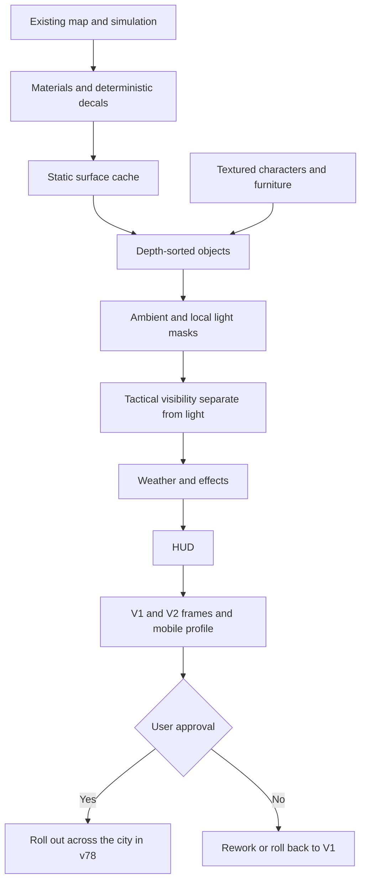

# Block-96 — Master Plan v74–v80 and Visual V2

Basis: project discussion, the v73 technical audit, and the user's video references. The plan does not mean the work has been done.

## Status (updated after release v75)
- Release **v75 is shipped** (the public site runs on it). Our releases continue from **v76**: the next release is the one planned as v76 below.
- **Done:** v74.3 (portable test harness) and v74.4 (PPS test selector). **Partly done:** v75.1 (baseline profiling and boot timing are measured in `docs/handoff/PROFILE_V75_1.md` and `PROFILE_V75_2.md`; real-device profiles are still missing). The v75 release also contains low-risk rendering and ray-query changes described in `docs/handoff/OPTIMIZATION_V75.md` (direct spatial-grid scan for `rayWall`/`rayWallAll`; fog and light layers at one backing pixel per CSS pixel on high-DPR canvases). That document uses its own sub-numbering, which does not map one-to-one onto the checklist below.
- All other items remain open. Checkbox legend: `[x]` done, `[~]` partly done, `[ ]` not done.

## General conditions
- Do not change the camera, city size, NPC count, balance, or rules without agreement. The stash is kept after death.
- Check the current branch and sources; do not treat version numbers as proof of the current state.
- One branch/PR per stage; baseline → change → tests → report → approval. Roll back with a revert or a feature flag. Do not weaken tests.
- Report: files, diff, tests with their actual status, measurements, risks, rollback. Do not present a headless tick as FPS.

## Control baseline from the v73 audit
2918×1946 m, 16 districts, 7 bridges, 1837 buildings, about 7770 containers, about 503 thousand wall segments. Night headless scenario: 621 NPCs, average step about 3.1 ms, boot+warm-up about 3.4–5 s. Real mobile FPS has not been measured. The road topology is connected through the bridges; physical passability of bridges and entrances is not proven. The PPS test selector is wrong; a broken AI is not proven. Save migrations were absent. Fog is a candidate for profiling. Re-check against the current branch.

## Sequence
### v74 — P0 — Stabilization
- [ ] v74.1 — Pin v73 or the current actual Git baseline; do not roll back newer changes.
- [ ] v74.2 — Check AGENTS.md, load order, syntax, and dependencies.
- [x] v74.3 — Fix the root tests/harness.js via path.resolve(__dirname,'..'); a single test command.
- [x] v74.4 — Fix the PPS selector in tests/behavior.test.js: pick the patrol of 3 members, do not change q.post to suit the test. Check FOV, warning, stand-down, and escalation on several seeds.
- [ ] v74.5 — Separate unit/fixture tests from full-world integration; full run of gangs/behavior/extras.
- [ ] v74.6 — Add normalization and step-by-step save migrations, backup, recovery, and a warning on write errors; check death, evacuation, and item transfer without losing the stash.
- [ ] v74.7 — Review data-dependent innerHTML, replace it with safe DOM APIs; add an untrusted-text test.
- [ ] v74.8 — Record baselines for load time, memory, CPU, and frame time; update the README.

**Acceptance:** All mandatory tests are green or the blockers are explicitly described; old saves are compatible; the stash is not lost; no balance changes.

### v75 — P1 — Performance (released; remaining items open)
- [~] v75.1 — Take CPU/GPU/heap profiles on real devices; record P50/P95/P99, boot, GC, night raid. *(Cloud baseline profile and boot timing done; real devices outstanding.)*
- [ ] v75.2 — Review the roughly 503 thousand collision segments; merge only those that are compatible and do not overlap doors/windows.
- [ ] v75.3 — Experiment with TypedArray/packed geometry behind the wallsNear/rayWall API; compare against the collision corpus.
- [ ] v75.4 — Measure caching of static surfaces, limit cache memory.
- [ ] v75.5 — Profile modules/vision.js; experiment with a half-res mask, adaptive DPR, and graphics presets; gameplay visibility unchanged.
- [ ] v75.6 — Check long raids and Android/iOS heating; do not reduce NPCs.

**Acceptance:** A measurable improvement over the baseline on the same scene; identical collisions and detection. Do not accept an optimization without measurements.

### v76 — P1 — Reference graphics quarter (next release)
- [ ] v76.1 — Choose a fixed quarter: street, residential building, commercial object, depot/industrial zone; seed, camera, time of day.
- [ ] v76.2 — Build a switchable Visual V2 mode without changing the projection, coordinates, or simulation.
- [ ] v76.3 — Materials: asphalt, concrete, brick, metal, ground; wear, cracks, dirt, snow/ice; deterministic decals in a cache.
- [ ] v76.4 — A single ambient light plus local light masks with obstacles, contact shadows, street lamps, and flashes; eliminate double darkening; do not change tactical visibility.
- [ ] v76.5 — Modular facades, windows, balconies, entrances, roofs; interior items by purpose; decorative does not mean collision or loot.
- [ ] v76.6 — Characters: first texture the existing skeleton; an alternative prototype of pre-rendered sprites with directions and animations.
- [ ] v76.7 — Vegetation, litter, vehicles, smoke, snow, weather, hit effects; a single HUD and icons.
- [ ] v76.8 — Original/licensed assets with a license registry; reference frames for day/night/interior and combat; compare V1/V2 on a phone.

**Acceptance:** The user approves the reference quarter from frames and video; the mobile budget is met or a compromise is agreed; V1 mode remains available for rollback.

### v77 — P1 — Navigation and physics
- [ ] v77.1 — Check the road topology including bridges; dynamically cross all 7 bridges in both directions with a car and with NPCs.
- [ ] v77.2 — For every intended entrance, check the outer and inner points, the opening width, and the route to the pedestrian network; document exceptions.
- [ ] v77.3 — Check doors, stairs, floors, vehicles, and agent sizes; separate vehicle and pedestrian navigation.
- [ ] v77.4 — Check routes between the 16 districts; detect lack of progress.
- [ ] v77.5 — Only if proven necessary: a global graph + local A*, a route queue/cache, and invalidation.

**Acceptance:** 7/7 bridges are passable; all intended entrances are accessible or have an explicit exception; no critical stuck states.

### v78 — P2 — Graphics scaling
- [ ] v78.1 — Spread the approved materials and facades across the districts while keeping the geometry.
- [ ] v78.2 — District individuality; residential, commercial, industrial, and administrative interiors.
- [ ] v78.3 — Improve characters, equipment, vehicles, animations, weather, and HUD.
- [ ] v78.4 — Image chunk caching with a memory limit; license registry; scene checks on different devices.

**Acceptance:** The whole city is consistent with the approved style; no critical regressions in memory, loading, or frame time.

### v79 — P2 — AI and population
- [ ] v79.1 — Check the FSM, perception/hearing/memory of the last contact, and target search without hidden coordinates.
- [ ] v79.2 — Separate individual decisions, squad, and faction where proven necessary; check PPS and schedules.
- [ ] v79.3 — Check independent faction events and mass clashes.
- [ ] v79.4 — If a hotspot is confirmed, trial a Simulation LOD with hysteresis and priority for combat/visibility/hearing; do not switch off the life of distant NPCs.
- [ ] v79.5 — Preserve health, ammunition, targets, identity, and faction across LOD transitions; test with identical seeds.

**Acceptance:** No artificial awareness and no disappearances caused by LOD; population is preserved; the gain is measured if LOD is introduced.

### v80 — P3 — World architecture and release
- [ ] v80.1 — Based on the profile, evaluate chunked storage, preloading, and lazy interiors; do not introduce them unless necessary.
- [ ] v80.2 — Deterministic seeds per chunk/building/container; stable IDs; preserve searched containers and world state.
- [ ] v80.3 — If needed, IndexedDB with transactions and migrations; compatibility with old saves.
- [ ] v80.4 — Long Android/iOS raids, full regression, documentation, and a stable release.

**Acceptance:** No critical errors, no item loss or duplication; stability on the agreed devices is proven.

## Schematic approach to the video references

Goal: atmosphere and detail, not copying the camera or someone else's assets. Keep the current isometric projection, the scale, the 2003 Ukraine setting, and the winter surroundings (check against the current TEXTURES.md).



| Node | Technical solution | Check |
|---|---|---|
| Material | Base + wear + dirt + seasonal layer; texFill/bakeTile (verify current names) | No noticeable repetition, stable seed |
| Facades | Modular windows, panels, doors, balconies, roofs; game.js prism/drawBuilding/drawPorches | Scale and openings unchanged |
| Light | Ambient + street-lamp masks with obstacles, contact shadows; game.js, modules/vision.js, candidate modules/lighting.js | No light through opaque walls, no double darkening |
| Characters | modules/characters.js: the existing skeleton/IK with textured parts; alternatively pre-rendered sprites | Readable silhouettes; walking, running, crouching, aiming, reloading |
| Interiors | modules/interiors.js / interiors_sim.js, item library, anchor points and shadows | Decor does not create new loot/collision unless specified |
| Atmosphere | Snow, smoke, flashes, tracks, a limited particle budget | HUD visibility and gameplay readability |
| Rendering | Canvas 2D first; PixiJS/WebGL only after a comparative profile | P95/P99, heap, boot, and frame quality |

### Control scenes
- Day: street and facades, snow/ice, and wear.
- Night: a courtyard, street lamps, obstacles, and deep shadows.
- Interior: a residential/commercial room, furniture, and passages.
- Depot: a firefight, directional light, smoke, and flashes.
Use the same seed, camera, world state, and resolution for V1/V2. Record video and screenshots; compare them with the user's original clips VID_20261126_204249_801.mp4 and VID_20261126_204315_835.mp4 (provide them to Codex privately if they are not in the repository). The diagram is conceptual, not a finished screenshot.

### Layer principle
```
HUD
Weather / screen effects
Tactical visibility (a separate gameplay mask)
Lighting / dynamic shadows
Geometry and entities, depth-sorted
Contact shadows / decals
Ground / road materials
```
Refine the order of the individual passes by experiment; walls and characters must not be drawn unconditionally in different global layers without depth sorting.


## Release criteria
Target 30 FPS on the agreed low-end device and 60 on a high-end one; P95 frame time ≤33.3/16.7 ms respectively. Record P99 and long stalls. 7 bridges, all intended entrances, save compatibility, no critical errors, and no stash loss. These targets are not measured results.

## Technical references
S.T.A.L.K.E.R./OpenXRay — continuous NPC life; Project Zomboid — chunk caching; ZERO Sievert — perception; Escape from Duckov — save recovery; Cataclysm DDA — streaming; Suroi — browser rendering; AAA AI LOD and hierarchical navigation. Study the principles, do not copy closed code.
- https://github.com/OpenXRay/xray-16
- https://github.com/CleverRaven/Cataclysm-DDA
- https://github.com/HasangerGames/suroi
- https://github.com/recastnavigation/recastnavigation
- https://developer.mozilla.org/en-US/docs/Web/API/Canvas_API/Tutorial/Optimizing_canvas
- https://web.dev/articles/offscreen-canvas

## Limitations
The video files and the original audit are not published automatically: the repository is public. The v73 data comes from the earlier discussion and audit; the current state of the code has not yet been verified. Stage numbers and parameters are proposals.
