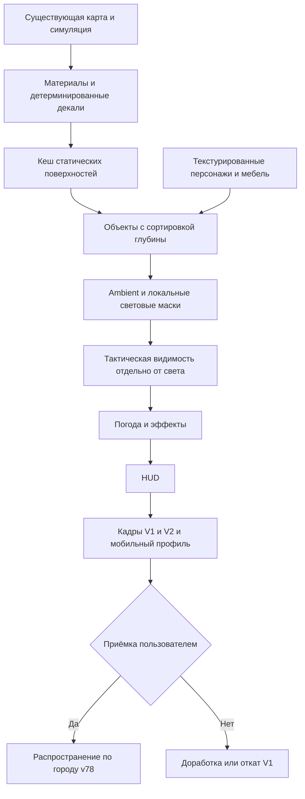

# Block-96 — единый генеральный план v74–v80 и Visual V2

Основание: обсуждение проекта, технический аудит v73 и пользовательские видеореференсы. План не означает выполненные работы.

## Общие условия
- Не менять камеру, размер города, численность NPC, баланс и правила без согласования. Склад после смерти сохраняется.
- Проверить актуальную ветку и исходники; не считать номера версий доказательством текущего состояния.
- Отдельная ветка/PR на этап; baseline → изменение → тесты → отчёт → утверждение. Откат через revert или feature flag. Не ослаблять тесты.
- Отчёт: файлы, diff, тесты с фактическим статусом, замеры, риски, откат. Не выдавать headless tick за FPS.

## Контрольная база из аудита v73
2918×1946 м, 16 районов, 7 мостов, 1837 зданий, около 7770 контейнеров, около 503 тыс. сегментов стен. Ночной headless сценарий 621 NPC, средний шаг около 3,1 мс, boot+warmup около 3,4–5 с. Реальный мобильный FPS не измерен. Топология дорог связна с мостами; физическая проходимость мостов и входов не доказана. Селектор теста ППС ошибочен, поломка AI не доказана. Миграции сохранений отсутствовали. Fog — кандидат для профилирования. Перепроверить по актуальной ветке.

## Последовательность
### v74 — P0 — Стабилизация
- [ ] v74.1 — Зафиксировать v73 либо текущую фактическую базу Git; не откатывать более новые изменения.
- [ ] v74.2 — Проверить AGENTS.md, порядок загрузки, синтаксис и зависимости.
- [ ] v74.3 — Исправить root tests/harness.js через path.resolve(__dirname,'..'); единая команда тестов.
- [ ] v74.4 — Исправить селектор ППС в tests/behavior.test.js: выбирать patrol из 3 участников, не менять q.post ради теста. Проверять FOV, предупреждение, прекращение и эскалацию на нескольких seed.
- [ ] v74.5 — Разделить unit/fixture и full-world integration; полный прогон gangs/behavior/extras.
- [ ] v74.6 — Добавить нормализацию и пошаговые миграции сохранений, backup, восстановление, предупреждение об ошибках записи; проверить смерть, эвакуацию и перенос предметов без потери склада.
- [ ] v74.7 — Проверить data-dependent innerHTML, заменить безопасными DOM API; тест недоверенного текста.
- [ ] v74.8 — Зафиксировать baseline времени загрузки, памяти, CPU и кадра, обновить README.

**Приёмка:** Все обязательные тесты зелёные либо блокеры явно описаны; старые сохранения совместимы; склад не теряется; никаких изменений баланса.

### v75 — P1 — Производительность
- [ ] v75.1 — Снять CPU/GPU/heap профили на реальных устройствах; фиксировать P50/P95/P99 и boot, GC, ночной рейд.
- [ ] v75.2 — Проверить около 503 тыс. сегментов коллизий; объединять лишь совместимые без перекрытия дверей/окон.
- [ ] v75.3 — Эксперимент TypedArray/packed geometry за API wallsNear/rayWall; сравнить корпус коллизий.
- [ ] v75.4 — Измерить кеширование статических поверхностей, ограничить память кеша.
- [ ] v75.5 — Профилировать modules/vision.js; эксперимент half-res маски, адаптивный DPR, графические пресеты; игровая видимость неизменна.
- [ ] v75.6 — Проверить длительные рейды и нагрев Android/iOS; не сокращать NPC.

**Приёмка:** Измеримое улучшение по baseline на одинаковой сцене; идентичные коллизии и обнаружение. Не принимать оптимизацию без измерений.

### v76 — P1 — Эталонный графический квартал
- [ ] v76.1 — Выбрать фиксированный квартал: улица, жилой дом, торговый объект, депо/промзона; seed, камера, время суток.
- [ ] v76.2 — Сделать переключаемый режим Visual V2, не меняя проекцию, координаты и симуляцию.
- [ ] v76.3 — Материалы: асфальт, бетон, кирпич, металл, земля; износ, трещины, грязь, снег/наледь; детерминированные декали в кеше.
- [ ] v76.4 — Единый ambient и локальные световые маски с препятствиями, контактные тени, фонари и вспышки; исключить двойное затемнение; не менять тактическую видимость.
- [ ] v76.5 — Модульные фасады, окна, балконы, подъезды, крыши; предметы интерьеров по назначению; декоративное не равно коллизиям или луту.
- [ ] v76.6 — Персонажи: сначала текстурировать существующий скелет; альтернативный прототип предрендеренных спрайтов с направлениями и анимациями.
- [ ] v76.7 — Растительность, мусор, транспорт, дым, снег, погода, эффекты попаданий; единый HUD и иконки.
- [ ] v76.8 — Оригинальные/лицензированные ассеты с реестром лицензий; контрольные кадры день/ночь/интерьер, бой; сравнить V1/V2 на телефоне.

**Приёмка:** Пользователь утверждает эталонный квартал по кадрам и видео; мобильный бюджет соблюдён либо согласован компромисс; режим V1 доступен для отката.

### v77 — P1 — Навигация и физика
- [ ] v77.1 — Проверить топологию дорог с учётом мостов; динамически пройти все 7 мостов в обе стороны автомобилем и NPC.
- [ ] v77.2 — Для каждого предусмотренного входа проверять наружную и внутреннюю точки, ширину проёма и маршрут до пешеходной сети; исключения документировать.
- [ ] v77.3 — Проверить двери, лестницы, этажи, транспорт и размеры агентов; разделить автомобильную и пешеходную навигацию.
- [ ] v77.4 — Проверить маршруты между 16 районами, обнаружение отсутствия прогресса.
- [ ] v77.5 — Только при доказанной необходимости: глобальный граф + локальный A*, очередь/кеш маршрутов и инвалидирование.

**Приёмка:** 7/7 мостов проходимы; все предусмотренные входы доступны или имеют явное исключение; отсутствие критических застреваний.

### v78 — P2 — Масштабирование графики
- [ ] v78.1 — Распространить утверждённые материалы и фасады по районам, сохраняя геометрию.
- [ ] v78.2 — Индивидуальность районов; жилые, коммерческие, промышленные и административные интерьеры.
- [ ] v78.3 — Улучшить персонажей, экипировку, транспорт, анимации, погоду и HUD.
- [ ] v78.4 — Кеширование чанков изображений с лимитом памяти; реестр лицензий; проверка сцен на разных устройствах.

**Приёмка:** Весь город выдержан в утверждённом стиле; нет критических регрессий памяти, загрузки или кадра.

### v79 — P2 — AI и население
- [ ] v79.1 — Проверить FSM, восприятие/слух/память последнего контакта и поиск цели без скрытых координат.
- [ ] v79.2 — Разделить индивидуальные решения, отряд и фракцию при доказанной необходимости; проверить ППС и расписания.
- [ ] v79.3 — Проверить независимые события фракций и массовые столкновения.
- [ ] v79.4 — При подтверждённом hotspot испытать Simulation LOD с hysteresis, приоритетом боя/видимости/слуха; не выключать жизнь дальних NPC.
- [ ] v79.5 — Сохранять здоровье, боезапас, цели, идентичность и фракцию при переходе LOD; тестировать одинаковые seed.

**Приёмка:** Нет искусственной осведомлённости и исчезновений из-за LOD; сохранена численность; выигрыш измерен, если LOD внедрён.

### v80 — P3 — Архитектура мира и релиз
- [ ] v80.1 — По результатам профиля оценить chunked storage, предзагрузку и lazy interiors; не вводить без необходимости.
- [ ] v80.2 — Детерминированные seed по chunk/building/container; стабильные ID; сохранять обысканные контейнеры и состояние мира.
- [ ] v80.3 — При необходимости IndexedDB с транзакциями и миграциями; совместимость старых сохранений.
- [ ] v80.4 — Длительные Android/iOS рейды, полный regression, документация и стабильный релиз.

**Приёмка:** Отсутствуют критические ошибки, потеря или дублирование предметов; стабильность на согласованных устройствах доказана.

## Схематическое приближение к видеореференсам

Цель: атмосфера и детализация, а не копирование камеры или чужих ассетов. Сохранить текущую изометрическую проекцию, масштаб, сеттинг Украины 2003 года и зимнее окружение (сверить с актуальным TEXTURES.md).



| Узел | Техническое решение | Проверка |
|---|---|---|
| Материал | База + износ + грязь + сезонный слой; texFill/bakeTile (проверить актуальные имена) | Нет заметной повторяемости, стабильный seed |
| Фасады | Модульные окна, панели, двери, балконы, крыши; game.js prism/drawBuilding/drawPorches | Масштаб и проёмы неизменны |
| Свет | Ambient + маски фонарей с препятствиями, контактные тени; game.js, modules/vision.js, кандидат modules/lighting.js | Нет света через непрозрачные стены, нет двойного затемнения |
| Персонажи | modules/characters.js: существующий скелет/IK с текстурированными частями; альтернативно pre-render sprites | Читаемые силуэты, ходьба, бег, приседание, прицеливание, перезарядка |
| Интерьеры | modules/interiors.js / interiors_sim.js, библиотека предметов, точки привязки и тени | Декор не создаёт новый лут/коллизию без задания |
| Атмосфера | Снег, дым, вспышки, следы, ограниченный бюджет частиц | Видимость HUD и игровой читаемости |
| Рендер | Canvas 2D сначала; PixiJS/WebGL только после сравнительного профиля | P95/P99, heap, boot и качество кадра |

### Контрольные сцены
- Днём: улица и фасады, снег/наледь и износ.
- Ночью: двор, фонари, препятствия и глубокие тени.
- Внутри: жилое/торговое помещение, мебель и проходы.
- Депо: перестрелка, направленный свет, дым и вспышки.
Одинаковый seed, камера, состояние мира и разрешение для V1/V2. Записать видео и скриншоты; сравнить с оригинальными пользовательскими роликами VID_20261126_204249_801.mp4 и VID_20261126_204315_835.mp4 (предоставить Codex приватно, если отсутствуют в репозитории). Схема концептуальная, не готовый скриншот. 

### Принцип слоёв
```
HUD
Погода / экранные эффекты
Тактическая видимость (отдельная игровая маска)
Освещение / динамические тени
Геометрия и сущности, отсортированные по глубине
Контактные тени / декали
Материалы земли / дороги
```
Порядок отдельных проходов уточнить экспериментом; стены и персонажи не должны безусловно рисоваться разными глобальными слоями без depth sorting.


## Релизные критерии
Цель 30 FPS на согласованном слабом устройстве и 60 на производительном; P95 кадра ≤33,3/16,7 мс соответственно. Фиксировать P99 и длинные остановки. 7 мостов, все предусмотренные входы, совместимость сохранений, отсутствие критических ошибок и потерь склада. Цели не являются измеренными результатами.

## Технические ориентиры
S.T.A.L.K.E.R./OpenXRay — непрерывная жизнь NPC; Project Zomboid — кеширование чанков; ZERO Sievert — восприятие; Escape from Duckov — восстановление сохранений; Cataclysm DDA — подгрузка; Suroi — браузерный рендер; AAA AI LOD и иерархическая навигация. Изучать принципы, не копировать закрытый код.
- https://github.com/OpenXRay/xray-16
- https://github.com/CleverRaven/Cataclysm-DDA
- https://github.com/HasangerGames/suroi
- https://github.com/recastnavigation/recastnavigation
- https://developer.mozilla.org/en-US/docs/Web/API/Canvas_API/Tutorial/Optimizing_canvas
- https://web.dev/articles/offscreen-canvas

## Ограничения
Видеофайлы и исходный аудит не публикуются автоматически: репозиторий публичный. Сведения о v73 взяты из предыдущего обсуждения и аудита; текущее состояние кода ещё не проверено. Номера этапов и параметры являются предложениями.